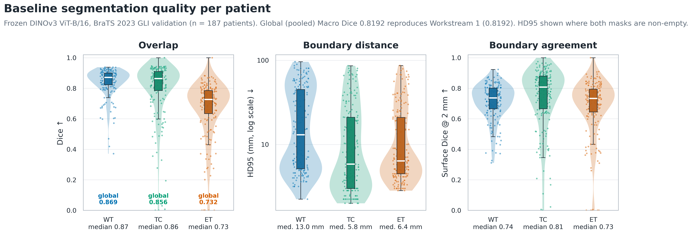
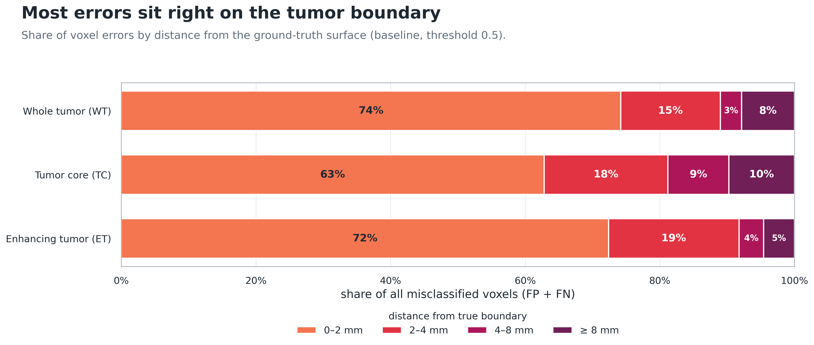
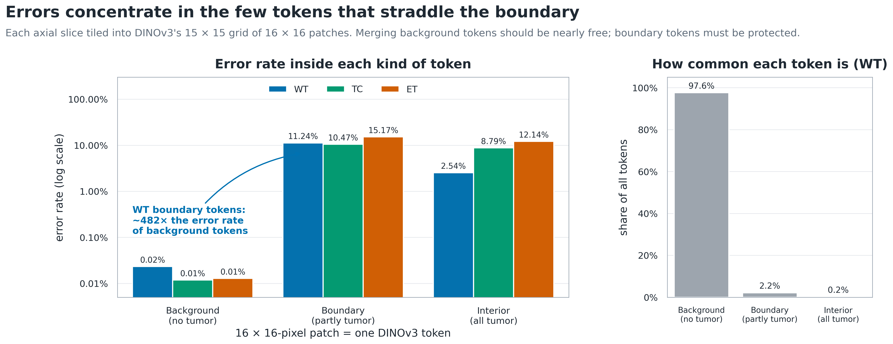
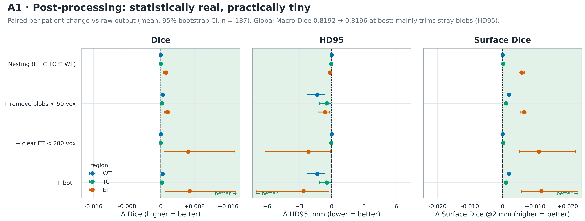
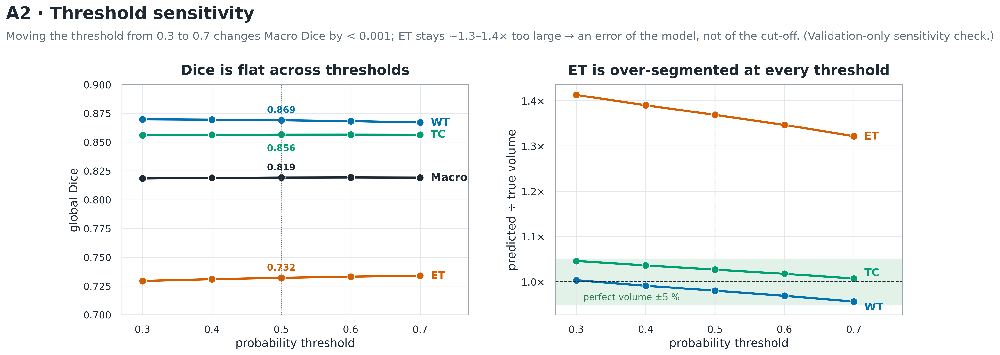
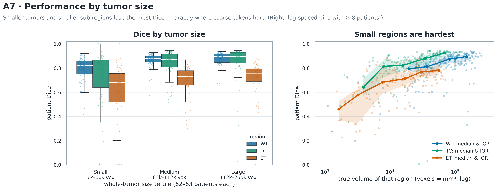
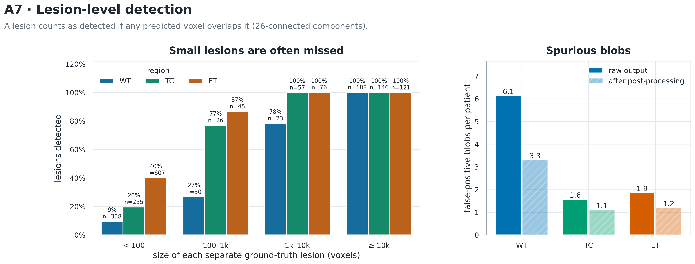
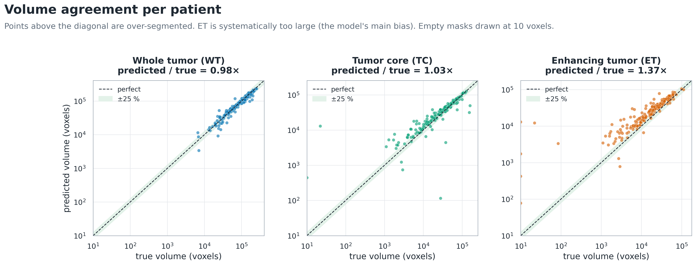

# Workstream 4: segmentation evaluation and ablations

`src/cap6411_atm/evaluation/` scores any model that maps `[B,4,240,240]`
images to `[B,3,240,240]` WT/TC/ET logits. Slices are reassembled into
`[3,240,240,155]` patient volumes, and every metric is computed **per
patient**, following BraTS convention. The cohort voxel-count Dice that
Workstream 1's `StreamingDice` reports is computed as well, so the baseline
number (validation Macro Dice 0.8192) can be reproduced.

| Module | Contents |
|---|---|
| `metrics.py` | Overlap, surface-distance, boundary-band, token-patch and lesion metrics |
| `postprocess.py` | Decision rules: threshold, ET ⊆ TC ⊆ WT nesting, small-component and small-total removal |
| `evaluator.py` | `evaluate_model` (one forward pass, many rules), `save_evaluation`, `build_eval_loader`, batch-level `evaluate` |
| `statistics.py` | Summaries, bootstrap CIs, paired Wilcoxon + Holm comparisons, strata, failure cases, report tables |
| `ablation.py` | `VariantSpec`, `merge_ratio_grid`, resumable `run_ablation`, `collect_results` |
| `provenance.py` | `build_provenance`, `fingerprint_file`: checkpoint / dataset / manifest fingerprints and the `run_key` that guards resumed results |
| `visualization.py` | Case overlays and error maps, token merge maps, metric-vs-ratio/latency plots, profiles |

The end-to-end Colab workflow is `notebooks/04_evaluation.ipynb`. For a
step-by-step guide to running A1, A2 and A7 (and what A3–A6 need), see
[`WORKSTREAM4_RUNBOOK.md`](WORKSTREAM4_RUNBOOK.md).

## Metrics

All metrics are reported per patient and per region (WT, TC, ET). Spacing is 1 mm isotropic.

| Metric | Definition |
|---|---|
| Dice, sensitivity, precision | Voxel overlap; TP/FP/FN counts and volumes are stored too |
| HD95 | max(95th percentile pred→GT, 95th percentile GT→pred) of surface distances (MONAI convention) |
| ASSD | Mean of all symmetric surface distances |
| NSD@τ | Share of surface voxels within τ mm of the other surface (τ = 1, 2 mm), from Nikolov et al. Uses surface-voxel counts, not surface area |
| Boundary bands | FP/FN voxels by distance from the GT surface: [0,2), [2,4), [4,8), ≥8 mm. Error rates are given for the bounded bands |
| Token patches | Each axial slice is tiled into 16×16 patches (exactly the DINOv3 token footprints). A patch is *background* (no tumor), *boundary* (partly tumor) or *interior* (all tumor). Reports (FP+FN)/pixels for each class |
| Lesions | 26-connected GT components binned by size (<100, 100–1k, 1k–10k, ≥10k voxels): count and detected (any overlap). Also predicted components that touch no GT (false-positive components) |

Surfaces are mask voxels with a 6-connected background neighbour.

**Empty masks.** When both masks are empty: Dice 1, NSD 1, HD95 0. When exactly
one is empty: Dice 0, NSD 0, HD95 = ASSD = 373.13 mm (the volume diagonal,
following BraTS). Sensitivity is NaN for an empty GT and precision is NaN for
an empty prediction. Summaries skip NaNs and report `n_missing`.
`status` records which case applies.

**Why the boundary and patch metrics.** Token merging pools 16×16 patches.
If adaptive merging works as intended, it should change errors in *interior*
and *background* patches but leave *boundary* patches and the 0–2 mm band
nearly unchanged. Uniform merging and lower resolution are expected to
degrade exactly those. These two analyses test the project's
boundary-preservation claim directly.

## Statistics

The patient is the unit of analysis.

- **Summaries:** `summarize` gives the mean, std, median, IQR and a 95%
  percentile-bootstrap CI (10,000 resamples) for each method, region and
  metric.
- **Paired comparisons:** `paired_comparison(frame, reference)` reports, per
  patient, the mean and median difference with a bootstrap CI, counts of
  patients improved and degraded (direction-aware: lower HD95 is better), and
  Wilcoxon signed-rank p-values, Holm-adjusted across the compared methods
  within each metric × region.
- **Tables:** `format_table(..., latex=True)` writes a CVPR-ready
  `mean ± std` table.

## Planned ablations

All variants share the same 187 validation patients, preprocessing, threshold and `MetricConfig`.

| # | Ablation | Variants | Needs |
|---|---|---|---|
| A1 | Decision rule | raw, nesting, small-component removal (50 vox), ET total < 200 vox cleared | Baseline only, available now |
| A2 | Threshold | 0.3 / 0.4 / 0.5 / 0.6 / 0.7 | Baseline only, available now |
| A3 | Merge ratio | uniform and adaptive at r ∈ {0.1, 0.25, 0.4, 0.5} | WS2 |
| A4 | Adaptive vs uniform at equal r | paired comparison, boundary bands, token patches | WS2 |
| A5 | Matched latency | adaptive vs reduced resolution at similar latency | WS2 + WS3 latencies (`plot_metric_vs_x(x_values=...)`) |
| A6 | Merge design | merge location (blocks), boundary-token protection, reconstruction method | WS2 options exposed via `VariantSpec.params` |
| A7 | Tumor size and small lesions | small/medium/large WT strata, ET lesion recall per size bin | Any of the above |

A1 and A2 cost no extra GPU time: `evaluate_model` applies every rule to the same forward pass.

## Running

```python
from cap6411_atm.evaluation import (
    VariantSpec, build_eval_loader, build_provenance, run_ablation, summarize, paired_comparison,
    POSTPROCESSING_ABLATION,
)

loader = build_eval_loader(archive, manifest, "configs/brats2023_gli_inspection.json",
                           split="validation", batch_size=16)
provenance = build_provenance(
    checkpoint={"dinov3": dinov3_checkpoint, "adapter_decoder": artifact},
    dataset=archive, manifest=manifest, inspection_config="configs/brats2023_gli_inspection.json",
)
variants = [VariantSpec("baseline", rules=POSTPROCESSING_ABLATION)]
frame = run_ablation(variants, lambda spec: model, loader, "/drive/.../results/ws4",
                     provenance=provenance, device="cuda")
summary = summarize(frame)
comparison = paired_comparison(frame, reference="baseline")
```

Output per variant goes to `<output>/<variant>/per_patient.csv` (one row per
rule × patient × region) and `summary.json` (metadata, rules, global Dice,
git commit). These files contain patient IDs, so keep them in restricted
storage. Commit only aggregate tables and figures that contain no MRI.

**Cost.** A full validation pass on a T4 takes about 11 minutes of forward
passes plus about 0.5 s per patient per rule for metrics on the CPU.
`forward_seconds` is not a latency benchmark; use Workstream 3's tools for
latency.

### Command-line scripts (local GPU)

`scripts/` reproduces the baseline results without the notebook. Private inputs are
passed as flags or as `CAP6411_*` environment variables (see `scripts/_ws4_paths.py`);
nothing private is hard-coded.

| Script | Does | Output |
|---|---|---|
| `ws4_run_baseline.py --out DIR` | One forward pass over the 187 validation patients, scored under the 5 A1 rules and 4 extra A2 thresholds; checks the Workstream 1 Macro Dice | `DIR/validation187/baseline/per_patient.csv` (patient IDs, private) |
| `ws4_analyze.py RUN_DIR` | A1, A2 and A7 tables (CSV + LaTeX) and quick-look plots | `RUN_DIR/analysis/` |
| `ws4_figures.py RUN_DIR [OUT]` | The presentation figures below (seaborn, colorblind-safe, seeded) | `RUN_DIR/figures/` |
| `ws4_qualitative.py RUN_DIR` | MRI case figure (good / typical / hard) with the token grid | contains MRI: keep private |

On an RTX 4080 the full baseline run takes about 22 minutes, mostly CPU metric time.

## Baseline results (validation, n = 187)

Frozen DINOv3 ViT-B/16 + Workstream 1 epoch-2 adapter/decoder, threshold 0.5.
The pooled Macro Dice is **0.819172**, which reproduces Workstream 1's 0.819176
(the difference comes from fp16 autocast).

| Region | Pooled Dice | Patient Dice, mean (95% CI) | HD95, median | Surface Dice @ 2 mm, mean |
|---|---|---|---|---|
| WT | 0.869 | 0.843 (0.829–0.856) | 13.0 mm | 0.71 |
| TC | 0.856 | 0.800 (0.773–0.825) | 5.8 mm | 0.74 |
| ET | 0.732 | 0.668 (0.640–0.694) | 6.4 mm | 0.68 |

- **Where errors are.** 74% of WT errors (63% TC, 72% ET) lie within 2 mm of
  the ground-truth surface. In 16×16 token patches that straddle the WT
  boundary, the error rate is 11.2%; in background patches it is 0.02%
  (about 480× lower). Boundary patches are only 2.2% of all tokens. Merging
  background tokens should therefore cost little, while boundary tokens need
  protecting. This is the reference for A4.
- **A1, decision rules.** The best rule (nesting, removing components under
  50 voxels, clearing ET under 200 voxels) moves Macro Dice from 0.8192 to
  0.8196. It lowers ET HD95 by 2.6 mm (95% CI 0.2–7.0; better for 108
  patients, worse for 10) and cuts WT false-positive components from 6.1 to
  3.3 per patient.
- **A2, threshold.** Macro Dice stays within 0.8184–0.8193 for thresholds 0.3 to
  0.7. ET is over-segmented at every threshold (1.41× the true volume at 0.3,
  1.32× at 0.7), so this is a model bias, not a threshold problem. The sweep
  is a validation-only sensitivity check, not a tuned setting.
- **A7, size and small lesions.** In the smallest WT-size tertile, ET Dice is
  0.61 (vs 0.70 medium, 0.69 large). Detection of ET lesions under 100 voxels
  is 40% (n = 607), vs 87% for 100–1k voxels and 100% above 1k voxels.










## Interface for Workstreams 2 and 3

`build_model(spec)` must return a module or callable mapping normalized
`[B,4,240,240]` images to raw `[B,3,240,240]` logits. Reduced-resolution
models must upsample their logits back to 240×240 so they are scored against
the original-resolution targets.

Merge-state visualization: `visualization.plot_merge_map(image, assignment)`
takes the per-sample, row-major `[225]` original-to-merged assignment from
`docs/TOKEN_MERGING_INTEGRATION.md`.

## Guardrails

- **Test split.** `evaluate_model` refuses the `test` split unless
  `allow_test=True` is passed, and `build_eval_loader` never builds it. The
  split must be known and consistent: it is read from the dataset (and every
  wrapper around it), optionally declared with `split=...`, and checked
  against the `split` field of every batch. A missing, unknown or conflicting
  split is an error. Run the test split once, at the end, with the protocol
  fixed.
- **Complete volumes.** Each patient's slices must be contiguous (a
  non-shuffled `PatientLocalBatchSampler`) and must be exactly slices
  `0 … 154` (`expected_depth`, read from the dataset's `axial_depth`). Every
  patient the dataset lists must be evaluated. Partial volumes are refused
  unless `allow_partial_volumes=True` is passed for debugging, because
  surface and volume metrics are wrong on them.
- **Provenance and stale results.** `run_ablation` requires `provenance`
  (`build_provenance` fingerprints the checkpoint, dataset archive, split
  manifest and inspection config; the 13 GB archive is hashed from its size,
  first and last 64 MiB). The provenance, variant spec, rules, metric
  settings, split, patient list and volume depth form a `run_key` stored in
  `summary.json` together with the CSV's SHA-256. A finished variant is
  reused only if both still match; otherwise `run_ablation` raises instead of
  mixing stale numbers (pass `overwrite=True` or a new output directory).
- **No mixing experiments.** `collect_results` refuses variants that differ in
  split, patients, volume depth, metric settings, dataset, manifest or
  inspection config (`strict=False` loads legacy results without these
  checks). Checkpoints may differ per variant.
- **Paired statistics.** `paired_comparison` and `failure_cases` require every
  method to cover exactly the same patients and reject duplicate
  (method, region, patient) rows; `load_results` rejects loading a variant
  twice.
- Run the weight-free tests with
  `PYTHONPATH=src python -m unittest discover -s tests -t tests`
  (`tests/test_evaluation_safeguards.py` covers the guards above).
